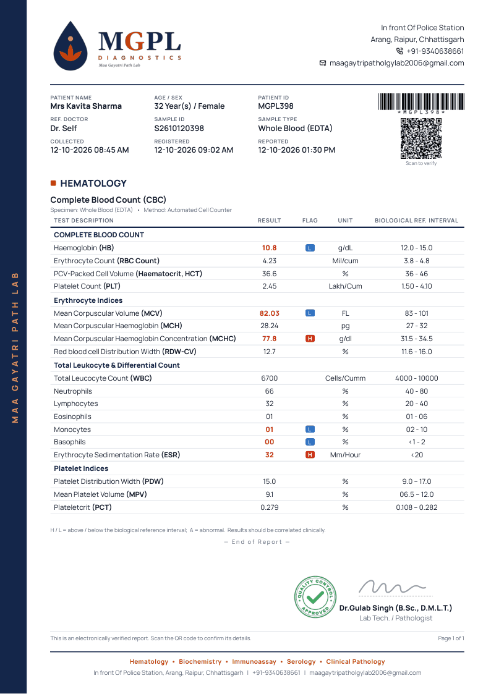
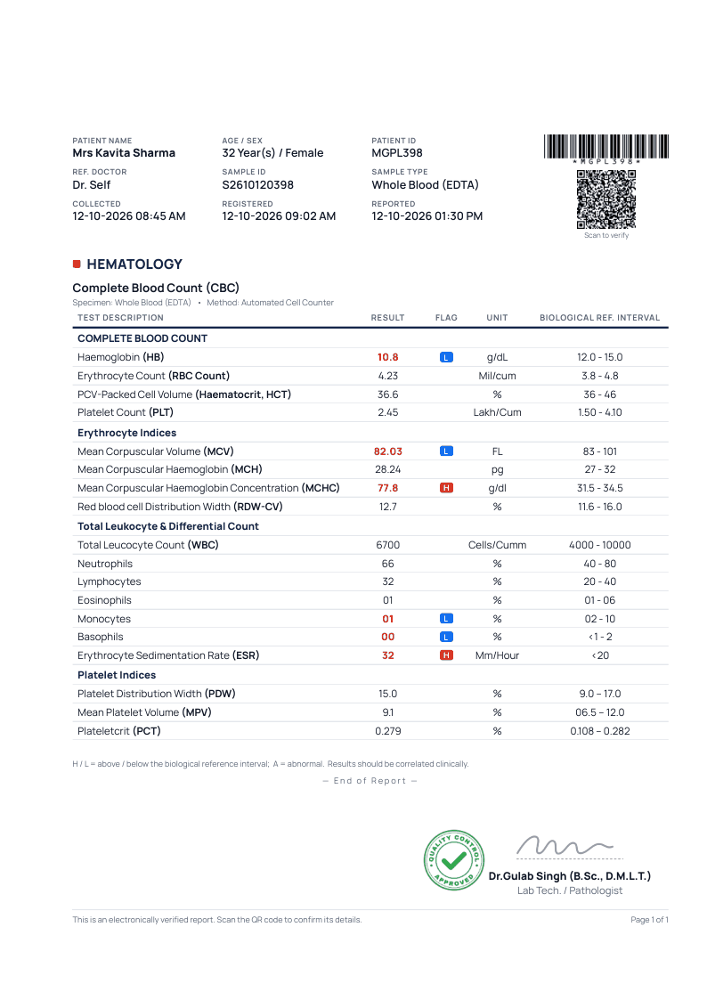
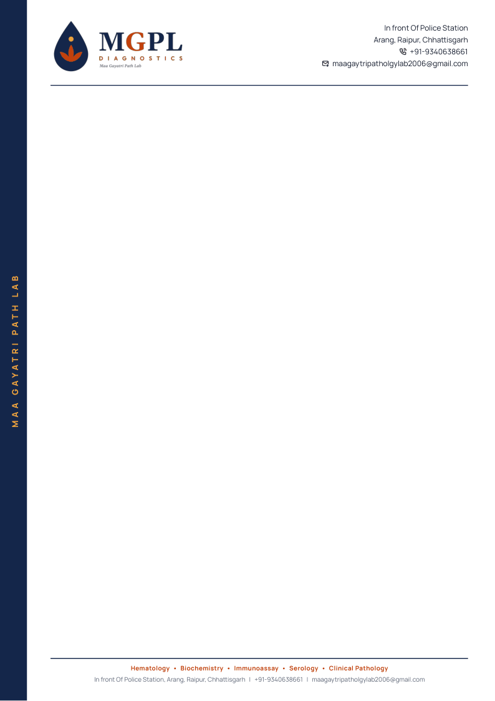
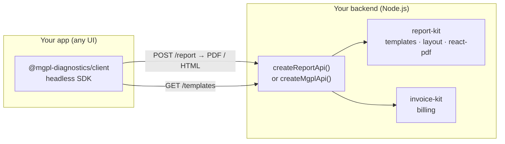
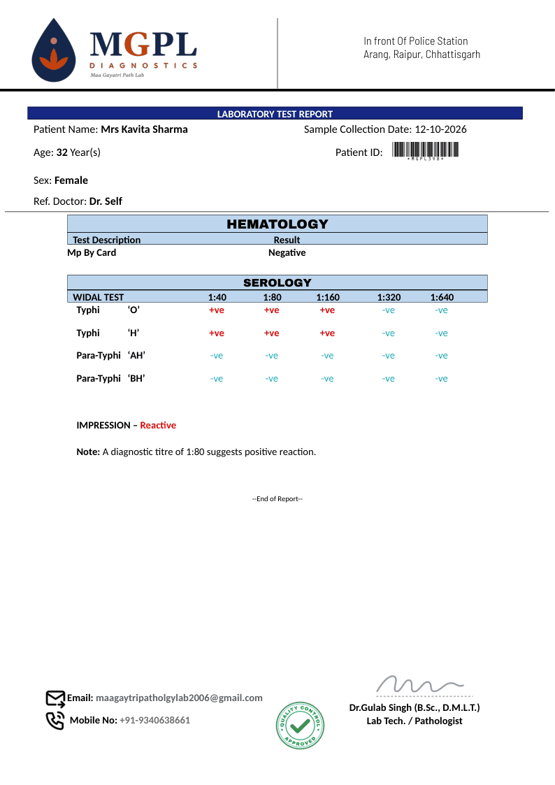

<div align="center">


# report-kit

**The backend that turns lab results into print-ready A4 reports, as PDF or HTML.**

Navy Sidebar and classic designs · header and pre-printed paper variants · 31 tests · scannable barcode and QR · no browser needed

[](#)
[](#)
[](#)
[](#mount-it-anywhere)
[](LICENSE)

[Quick start](#quick-start) · [API](#http-api) · [Templates](#tests-and-profiles) · [Configuration](#configuration) · [Printing](#printing) · [Docs](docs/api.md)

</div>

---

<table>
<tr>
<td width="33%"></td>
<td width="33%"></td>
<td width="33%"></td>
</tr>
<tr>
<td align="center"><b>Header</b><br/><sub>full letterhead, plain paper</sub></td>
<td align="center"><b>Non-header</b><br/><sub>same layout, for pre-printed paper</sub></td>
<td align="center"><b>Letterhead</b><br/><sub>print once, borderless</sub></td>
</tr>
</table>

## Why

The lab used to produce reports by hand-editing Word files, one copy per test. `report-kit` replaces that with
data → document:

- **Data in, A4 out.** You send a patient and their results; the backend returns a PDF or HTML page.
- **Accurate by construction.** H/L flags come from the reference range, male/female ranges are picked
  automatically, and long reports split across pages with *Page X of Y*.
- **Prints the same everywhere.** HTML and PDF share one geometry file and one row-height model, so they
  break pages in exactly the same places.
- **Backend only.** Rendering, fonts, images and PDF generation run in Node.js. Your frontend stays
  free to look however you want; it talks to this backend through [`@mgpl-diagnostics/client`](https://github.com/mgpl-diagnostics/client).

## How it fits



## Quick start

```bash
npm i @mgpl-diagnostics/report-kit react react-dom
```

<details>
<summary>Installing from GitHub Packages</summary>

```ini
# .npmrc
@mgpl-diagnostics:registry=https://npm.pkg.github.com
//npm.pkg.github.com/:_authToken=${GITHUB_TOKEN}   # token with read:packages
```

or straight from git: `npm i github:mgpl-diagnostics/report-kit#v2.0.0` (built on install).
</details>

```ts
import { buildReport, renderReportPdf } from "@mgpl-diagnostics/report-kit";

const report = buildReport(
  { title: "Mrs", name: "Kavita Sharma", age: 32, sex: "Female", patientId: "MGPL1025", refDoctor: "Self" },
  [
    { template: "cbc", results: { hb: "10.8", wbc: "6700", plt: "2.45" } },
    { template: "kft", results: { urea: "28", creatinine: "0.9" } },
  ],
);

const pdf: Buffer = await renderReportPdf({ report, variant: "header" }); // A4, ready to print or email
```

## Mount it anywhere

The HTTP API is a standard `(Request) => Response` handler, so it fits every Node.js backend:

<table>
<tr><th>Next.js (App Router)</th><th>Fastify</th></tr>
<tr>
<td>

```ts
// app/api/mgpl/[...path]/route.ts
import { createReportApi } from "@mgpl-diagnostics/report-kit";

const api = createReportApi({ basePath: "/api/mgpl" });
export { api as GET, api as POST, api as OPTIONS };
export const runtime = "nodejs";
```

</td>
<td>

```ts
import Fastify from "fastify";
import { mgplFastify } from "@mgpl-diagnostics/report-kit/fastify";

const app = Fastify();
await app.register(mgplFastify, { prefix: "/api/mgpl" });
await app.listen({ port: 4000 });
```

</td>
</tr>
<tr><th>Express / node:http</th><th>Hono · Bun · Deno</th></tr>
<tr>
<td>

```ts
import { createReportApi, toNodeHandler } from "@mgpl-diagnostics/report-kit";

app.use("/api/mgpl", toNodeHandler(createReportApi()));
// mount before express.json()
```

</td>
<td>

```ts
const api = createReportApi({ basePath: "/api/mgpl" });
app.all("/api/mgpl/*", (c) => api(c.req.raw));      // Hono
Bun.serve({ fetch: api });                           // Bun
```

</td>
</tr>
</table>

Need invoices too? Mount [`createMgplApi()` from invoice-kit](https://github.com/mgpl-diagnostics/invoice-kit) instead. It serves every report route as well.

## HTTP API

| Method & route | Body / query | Returns |
|---|---|---|
| `GET /templates` | | every test with its result fields + profiles (build entry forms from it) |
| `POST /report` | `{ patient, tests }` · `{ patient, profile }` · `{ report }` + `variant`, `design`, `format` | PDF (default) or HTML |
| `GET /letterhead` | `?format=pdf\|html` | blank stationery |
| `GET /assets/*` | | fonts and images used by the HTML output (cached for a year) |
| `GET /samples` | | demo reports, only with `samples: true` |
| `GET /health` | | `{ ok: true }` |

Errors are JSON `{ "error": "…" }` with `400` (bad input), `404`, `405`, `413` (body too large) or `500`.
`OPTIONS` preflight and `cors` are built in for frontends on another origin.

## Tests and profiles

| Department | Templates |
|---|---|
| **Hematology** | CBC · Haemoglobin · ESR · Blood group · Malaria (card) · BT/CT · PT/INR |
| **Biochemistry** | Blood sugar (F/PP/R) · HbA1c · LFT · RFT · KFT · Electrolytes · Lipid · Iron profile · single tests |
| **Immunoassay** | Thyroid (T3/T4/TSH/FT3/FT4) · Vitamin D · Vitamin B12 · PSA |
| **Serology** | Dengue · HIV/HBsAg/VDRL/HCV · Widal · Typhidot · Malaria antigen · CRP/ASO · RA factor |
| **Clinical pathology** | Urine routine · Urine pregnancy · Stool · Semen analysis |

**Profiles:** Fever · Diabetes · Liver & Kidney · Anaemia · Antenatal · Pre-operative · Full Body Check-up.

A result is either a string (`"10.8"`) or `{ value, flag?, range?, unit?, method? }`. Numeric results are
flagged **H/L** automatically. Use `flag: "abnormal"` for text results such as *Positive*.

<details>
<summary>Classic design (replica of the original Word reports)</summary>
<br/>


`design: "classic"`
</details>

## Configuration

| What | Where |
|---|---|
| Lab name, address, phone, email, signatory, footer lines | [`src/server/lab.ts`](src/server/lab.ts) (`MGPL_LAB`), or pass `lab` to any function |
| Logo, icons, QC stamp | replace files in [`assets/report-assets/`](assets/report-assets) (SVG or PNG) |
| **Real signature** | **never in git.** Set `MGPL_SIGNATURE_FILE` (or `MGPL_SIGNATURE_HEADER_FILE` / `MGPL_SIGNATURE_NONHEADER_FILE`) to a private image path on the server. The repo ships a placeholder. |
| QR verify link | `verifyBaseUrl` in the lab profile. Without it, the QR holds a plain-text summary. |
| CORS, body limit, demo samples | `createReportApi({ cors, maxBodyBytes, samples })` |

## Printing

| You want | Use | Printer setting |
|---|---|---|
| Pre-printed stationery | `GET /letterhead?format=pdf` | **Borderless**, Actual size |
| Report on plain paper | `variant: "header"` | Actual size |
| Report on stationery | `variant: "non-header"` | Actual size, paper guide snug |

## Project layout

```
src/server/      backend: templates, rendering (HTML + react-pdf), API, adapters
src/shared/      types + API contract
assets/          fonts (OFL), images, licences — shipped in the package
scripts/         smoke test, examples, asset sync
```

## Development

```bash
npm install          # also builds dist/ (prepare)
npm run typecheck
npm run smoke        # 156 renders: every sample × design × variant, HTML + PDF, text verified inside the PDFs
npm run examples     # examples/index.html — HTML + PDF of every sample
```

Read **[AGENTS.md](AGENTS.md)** before changing layout or templates. It lists the invariants and the
react-pdf pitfalls this project has already hit. Full API: **[docs/api.md](docs/api.md)**. AI index: [llms.txt](llms.txt) · [llms-full.txt](llms-full.txt).

## Part of MGPL Diagnostics

| Repo | Side | |
|---|---|---|
| **report-kit** | backend | reports, letterhead, templates |
| [invoice-kit](https://github.com/mgpl-diagnostics/invoice-kit) | backend | patient invoices + combined API |
| [client](https://github.com/mgpl-diagnostics/client) | frontend | headless SDK, zero dependencies |
| [report-studio](https://github.com/mgpl-diagnostics/report-studio) | app | Next.js reference app |

<sub>© MGPL Diagnostics (Maa Gayatri Path Lab). All rights reserved; see [LICENSE](LICENSE). Bundled fonts and icons keep their own licences; see [THIRD_PARTY_NOTICES.md](THIRD_PARTY_NOTICES.md). Reference ranges must be verified by a qualified pathologist.</sub>
